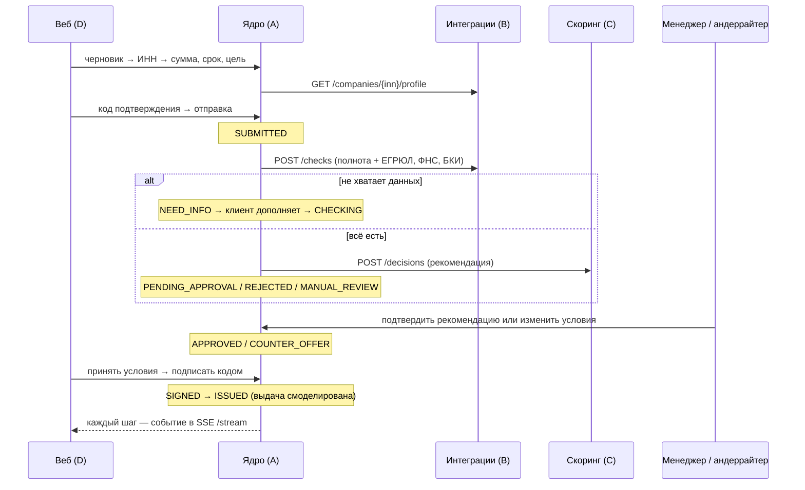

# Ядро кредитного конвейера (services/core)

Python 3.12, FastAPI, SQLAlchemy 2, Alembic, PostgreSQL 16. Владелец — область A.

## Что делает

- **Хранит заявку** и меняет её статус только через статусную машину (`app/statemachine.py`): разрешённые переходы и роли, которые могут их выполнять. Диаграмма — [statuses.md](statuses.md).
- **Ведёт журнал событий.** Из него строятся трекер клиента, уведомления и аудит.
- **Двигает заявку автоматически** через фоновый конвейер (`app/pipeline.py`): `SUBMITTED → CHECKING → SCORING → рекомендация`, затем `SIGNED → ISSUED`.
- **Не одобряет кредит автоматически.** Скоринг только рекомендует. «Одобрить» или «другие условия» → `PENDING_APPROVAL`: подтверждает менеджер или андеррайтер, условия подставлены из рекомендации. Автоматически — только отказ по стоп-факторам (`REJECTED`) и передача рисковых заявок андеррайтеру (`MANUAL_REVIEW`). Отказ сотрудником и решения по рисковым заявкам — только андеррайтер; менеджер может передать заявку андеррайтеру.
- **Отдаёт API** клиенту и банку (контракт — [contracts/core.yaml](../../contracts/core.yaml)) и поток событий SSE.
- **Аутентифицирует** демо-пользователей: JWT, роли `CLIENT`, `MANAGER`, `UNDERWRITER`.

## Конвейер

- **Очередь — сама таблица заявок.** Обработчик выбирает заявки в автоматических статусах. На PostgreSQL строки блокируются через `SELECT … FOR UPDATE SKIP LOCKED`, поэтому ядро можно запускать в нескольких экземплярах. После перезапуска незавершённые заявки подхватываются сами. Отдельный брокер (Kafka, RabbitMQ) для MVP не нужен; переход на него описан как развитие.
- **Сбой внешнего сервиса не роняет заявку.** Шаг откладывается с растущей паузой (2, 4, 8 … 60 с), клиент видит «Проверка занимает больше времени, чем обычно».
- **Пауза между шагами** `CORE_PIPELINE_STEP_DELAY_SECONDS` нужна для демо, чтобы движение статусов было видно глазами.

## Сервисы B и C

В `docker compose` ядро ходит в настоящие сервисы: `integrations` (B) и `scoring` (C), `CORE_*_MODE=http`. Встроенные заглушки ядра (`CORE_*_MODE=stub`) остались для тестов ядра и разработки без соседних сервисов. Они повторяют формат ответов, но логика решения у них упрощённая.

Демо-компании дают три исхода (проверено сквозным прогоном [deploy/e2e/scenarios.py](../../deploy/e2e/scenarios.py) на настоящих сервисах):

| Логин | Компания | Сценарий | Исход |
|---|---|---|---|
| `coffee` | ООО «Кофейня на Лесной» | «Экспресс-кредит», 2 млн на 12 мес. | Рекомендация **одобрить** → подтверждение `manager` → подпись → выдача |
| `stroy` | ООО «СтройМонтаж» | «Пополнение оборота», 10 млн на 12 мес. | Рекомендация **другие условия** 6,6 млн на 36 мес. → подтверждение `manager` |
| `vector` | ООО «Вектор Трейд» | Любая сумма | **Ручное рассмотрение**: просрочка 45 дней в БКИ |

Логика решения и пороги — в `services/scoring/rules/` и `services/scoring/README.md` (область C).

## Безопасность

- Пароли — PBKDF2-SHA256 (200 000 итераций). Коды подтверждения хранятся как HMAC, не больше 5 попыток, срок действия 5 минут, один код — одно действие.
- Клиент видит только заявки своей компании. На чужие заявки ответ 404, а не 403, чтобы не подтверждать их существование. Внутренние события банка (например, «взял в работу») клиенту не показываются.
- Демо-режим `CORE_DEMO_CODES=true` возвращает код подтверждения в ответе API, потому что SMS запрещены условиями кейса. В боевом режиме код ушёл бы в отдельный канал.
- Для SSE токен передаётся в параметре запроса, потому что EventSource не умеет заголовки. Ограничение известное: на проде стоит перейти на cookie или короткоживущий токен потока.

## Ограничения MVP и развитие

- Авторизация внутри ядра → Keycloak (OIDC), роли из realm.
- Очередь на таблице → брокер сообщений с outbox-паттерном.
- Опрос БД для SSE раз в секунду → LISTEN/NOTIFY или брокер.
- Компания = один пользователь → роли внутри компании (бухгалтер готовит, директор подписывает).
