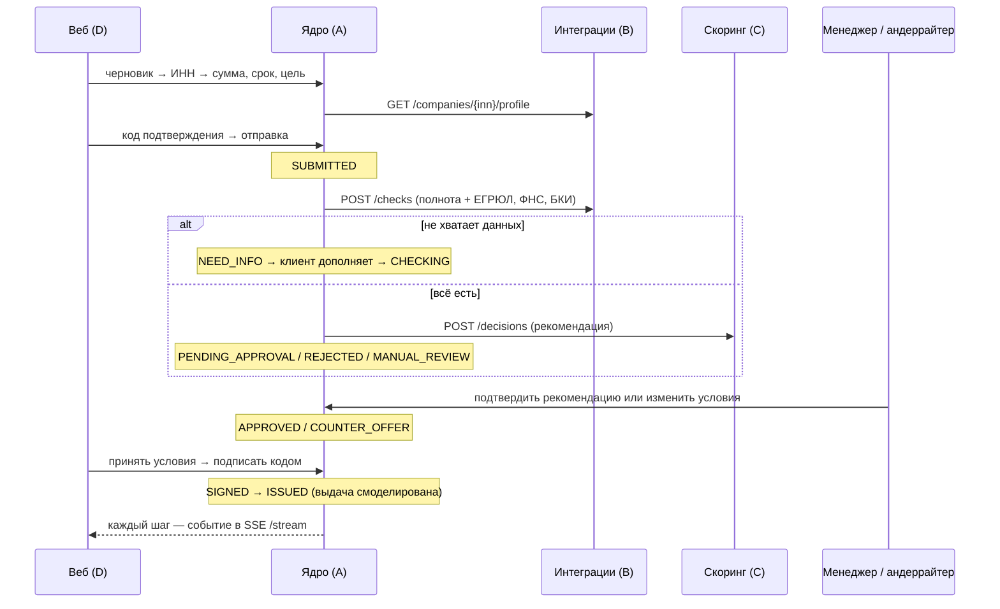

# Ядро кредитного конвейера (services/core)

Python 3.12, FastAPI, SQLAlchemy 2, Alembic, PostgreSQL 16. Владелец — область A.

## Что делает

- **Хранит заявку** и меняет её статус только через статусную машину (`app/statemachine.py`): разрешённые переходы и роли, которые могут их выполнять. Диаграмма — [statuses.md](statuses.md).
- **Ведёт журнал событий.** Из него строятся трекер клиента, уведомления и аудит.
- **Двигает заявку автоматически** через фоновый конвейер (`app/pipeline.py`): `SUBMITTED → CHECKING → SCORING → рекомендация`, затем `SIGNED → ISSUED`.
- **Не одобряет кредит автоматически.** Скоринг только рекомендует. «Одобрить» или «другие условия» → `PENDING_APPROVAL`: подтверждает менеджер или андеррайтер, условия подставлены из рекомендации. Автоматически — только отказ по стоп-факторам (`REJECTED`) и передача рисковых заявок андеррайтеру (`MANUAL_REVIEW`). Отказ сотрудником и решения по рисковым заявкам — только андеррайтер; менеджер может передать заявку андеррайтеру.
- **Назначает персонального менеджера** (S4.9) при отправке заявки — наименее загруженного; клиент видит его ФИО, должность, телефон и часы работы (`manager` в ответе). Менеджер, взявший заявку в работу, становится контактом клиента.
- **Обещает срок каждого этапа** (S4.6): `status.sla` — сколько обычно занимает этап, `status.due_at` — к какому времени банк обещает его завершить. Сроки заданы в `app/statemachine.py`, таблица — в [statuses.md](statuses.md).
- **Подбор продукта по цели** (S1.2): `GET /products/purposes` — цели из каталога сервиса C без повторов, в формулировках бизнеса клиента: отрасль — по ОКВЭД из профиля компании в сервисе B (правила в `app/purposes.py`, без ИИ; нет правил или B недоступен — цели как в каталоге), `POST /products/match` — правила без скрытой логики: цель из каталога, сумма и срок в рамках продукта, среди подходящих — самая низкая ставка. Для каждого продукта — пояснения клиенту, почему подходит или нет. Цель, сумма и срок переносятся в черновик заявки.
- **Предоценка по ИНН** (S2.1): `POST /precheck` — до заявки тот же путь, что у неё (профиль и проверки в B, решение в C), но без сохранения. Возвращает шанс (высокий / средний / низкий), сколько можно получить по продукту, ориентировочные условия и причины. Максимум — запрос на верхнюю границу продукта: скоринг либо соглашается, либо называет лимит.
- **Запрашивает документы** (S4.4, S4.7): сотрудник перечисляет документы и для каждого пишет, зачем он нужен (J9); заявка уходит клиенту в `NEED_INFO`, дополнить её можно только после загрузки всех файлов. Файлы (PDF, JPEG, PNG до 5 МБ) хранит сервис B, ядро ведёт запрос: пояснения и исходные имена файлов — в журнале заявки, поэтому не теряются и после ответа клиента. Сотрудник скачивает файлы из карточки.
- **Проверяет условия сотрудника** (S5.4) через скоринг (`POST /offers/check` сервиса C) по той же политике, что и автоматическое решение. Не проходят — менеджер подтвердить не может (видит причину и допустимую сумму), андеррайтер может только с обоснованием в комментарии: это сохраняется в `decision.override` и в истории банка (`POLICY_OVERRIDE`). Скоринг недоступен — решение не блокируется, сохраняется предупреждение. Для формы есть `POST /bank/applications/{id}/offer-check`: проверка без изменения заявки.
- **Один запрос клиенту** (S4.4): `POST /bank/applications/{id}/info-request` принимает и вопросы (`items`), и документы с пояснением (`documents`) — клиент получает их одним запросом. `document-request` остаётся для запроса только документов.
- **Чат по заявке** (S4.10): `GET/POST /applications/{id}/messages` для клиента (после отправки заявки) и `/bank/applications/{id}/messages` для сотрудников. Каждое сообщение пишет в журнал событие `MESSAGE`, поэтому собеседник получает его сразу по тому же SSE-потоку, что и статусы. Всё общение остаётся в кабинете — без почты и мессенджеров.
- **Дашборд узких мест** (S8.1): `GET /bank/dashboard?source=LIVE|DEMO` для сотрудников. LIVE — по журналу событий: время статуса — от перехода в него до следующего перехода, у заявок в работе — до текущего момента. По каждому этапу — сколько заявок прошли, медиана, 90-й перцентиль, сколько ждут сейчас и сколько вышли за обещанный срок. Узкое место — этап банка или автоматики с наибольшим суммарным временем; ожидание клиента показывается отдельно и в узкие места не входит. DEMO — тот же расчёт по синтетическому массиву сервиса B (`/api/v1/dashboard/applications`), чтобы показать дашборд на объёме.
- **Отдаёт API** клиенту и банку (контракт — [contracts/core.yaml](../../contracts/core.yaml)) и поток событий SSE.
- **Аутентифицирует** демо-пользователей: JWT, роли `CLIENT`, `MANAGER`, `UNDERWRITER`.

## Конвейер

- **Очередь — сама таблица заявок.** Обработчик выбирает заявки в автоматических статусах. На PostgreSQL строки блокируются через `SELECT … FOR UPDATE SKIP LOCKED`, поэтому ядро можно запускать в нескольких экземплярах. После перезапуска незавершённые заявки подхватываются сами. Отдельный брокер (Kafka, RabbitMQ) для MVP не нужен; переход на него описан как развитие.
- **Сбой внешнего сервиса не роняет заявку.** Шаг откладывается с растущей паузой (2, 4, 8 … 60 с), клиент видит «Проверка занимает больше времени, чем обычно».
- **Пауза между шагами** `CORE_PIPELINE_STEP_DELAY_SECONDS` нужна для демо, чтобы движение статусов было видно глазами.

## Сервисы B и C

В `docker compose` ядро ходит в настоящие сервисы: `integrations` (B) и `scoring` (C), `CORE_*_MODE=http`. Встроенные заглушки ядра (`CORE_*_MODE=stub`) остались для тестов ядра и разработки без соседних сервисов. Они повторяют формат ответов, но логика решения у них упрощённая.

Демо-компании дают три исхода (проверено сквозным прогоном [deploy/e2e/scenarios.py](../../deploy/e2e/scenarios.py) на настоящих сервисах):

| Логин | Компания | Сценарий | Исход |
|---|---|---|---|
| `coffee` | ООО «Кофейня на Лесной» | «Экспресс-кредит», 2 млн на 12 мес. | Рекомендация **одобрить** → подтверждение `manager` → подпись → выдача |
| `stroy` | ООО «СтройМонтаж» | «Пополнение оборота», 10 млн на 12 мес. | Рекомендация **другие условия** 6,6 млн на 36 мес. → подтверждение `manager` |
| `vector` | ООО «Вектор Трейд» | Любая сумма | **Ручное рассмотрение**: просрочка 45 дней в БКИ |

Логика решения и пороги — в `services/scoring/rules/` и `services/scoring/README.md` (область C).

## Безопасность

- Пароли — PBKDF2-SHA256 (200 000 итераций). Коды подтверждения хранятся как HMAC, не больше 5 попыток, срок действия 5 минут, один код — одно действие.
- Клиент видит только заявки своей компании. На чужие заявки ответ 404, а не 403, чтобы не подтверждать их существование. Внутренние события банка (например, «взял в работу») клиенту не показываются.
- Демо-режим `CORE_DEMO_CODES=true` возвращает код подтверждения в ответе API, потому что SMS запрещены условиями кейса. В боевом режиме код ушёл бы в отдельный канал.
- Для SSE токен передаётся в параметре запроса, потому что EventSource не умеет заголовки. Ограничение известное: на проде стоит перейти на cookie или короткоживущий токен потока.

## Ограничения MVP и развитие

- Авторизация внутри ядра → Keycloak (OIDC), роли из realm.
- Очередь на таблице → брокер сообщений с outbox-паттерном.
- Опрос БД для SSE раз в секунду → LISTEN/NOTIFY или брокер.
- Компания = один пользователь → роли внутри компании (бухгалтер готовит, директор подписывает).
