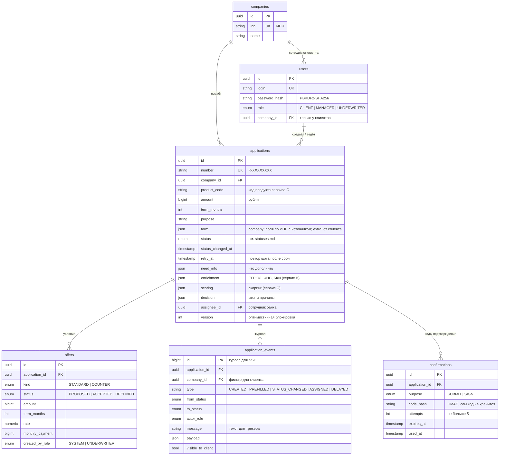

# Модель данных ядра

Схема БД ядра (PostgreSQL). Источник правды — `services/core/app/models.py`, миграции — `services/core/migrations/`.

## Почему так

- **Журнал событий отдельной таблицей.** Каждое изменение статуса пишется туда же, где меняется заявка, в одной транзакции. Из журнала строятся трекер клиента, SSE-уведомления, аудит («кто и когда принял решение») и статистика длительности этапов (S4.6, S8.1).
- **JSON для данных внешних сервисов.** Формат ответов B и C ещё меняется. Ядро хранит их как есть и не зависит от их внутренней структуры.
- **Деньги — целые рубли (`bigint`), ставка — `numeric(5,2)`.** Никаких float в суммах.
- **`version` — оптимистичная блокировка.** Если заявку одновременно меняют двое, второй получит 409 «Заявка изменилась, обновите страницу».
