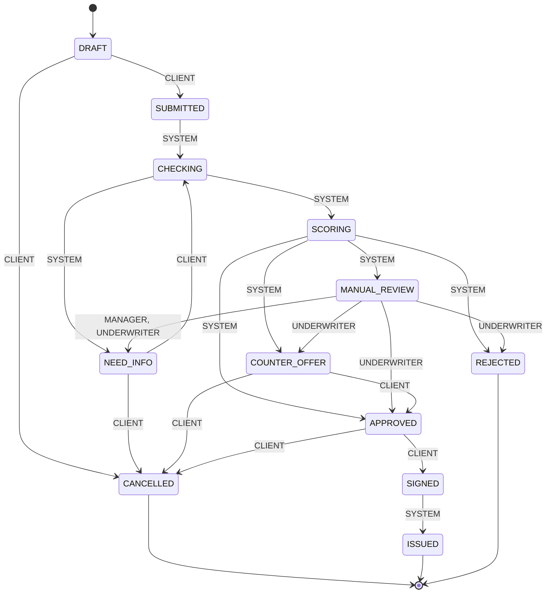

# Статусы заявки

> Файл сгенерирован из `services/core/app/statemachine.py` командой `python -m app.export_docs`. Руками не править.

На стрелках — кто выполняет переход: `CLIENT` — клиент, `SYSTEM` — автоматический конвейер, `MANAGER` / `UNDERWRITER` — сотрудники банка.

| Код | Название | Что видит клиент | Финальный |
|---|---|---|---|
| `DRAFT` | Черновик | Заполните заявку и отправьте её на рассмотрение |  |
| `SUBMITTED` | Отправлена | Заявка принята, скоро начнём проверку |  |
| `CHECKING` | Проверка данных | Проверяем данные компании в ЕГРЮЛ, ФНС и бюро кредитных историй |  |
| `NEED_INFO` | Нужны данные | Банку не хватает информации — дополните заявку |  |
| `SCORING` | Оценка | Оцениваем заявку и подбираем условия |  |
| `MANUAL_REVIEW` | У специалиста | Заявку изучает кредитный специалист |  |
| `APPROVED` | Одобрена | Проверьте условия и подпишите договор |  |
| `COUNTER_OFFER` | Другие условия | Банк готов выдать кредит на других условиях — посмотрите предложение |  |
| `REJECTED` | Отказ | Банк не может одобрить заявку сейчас | да |
| `SIGNED` | Подписана | Договор подписан, перечисляем деньги |  |
| `ISSUED` | Деньги зачислены | Кредит выдан, деньги на расчётном счёте | да |
| `CANCELLED` | Отменена | Заявка отменена | да |
