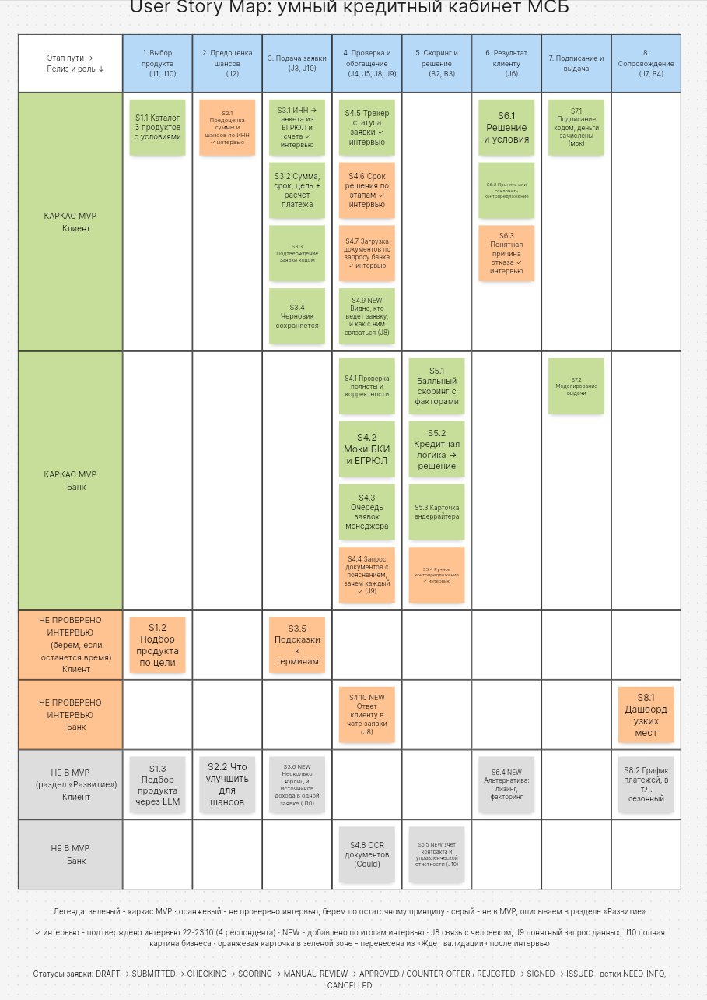

# User Story Map

Карта пользовательских историй кредитного кабинета МСБ после интервью 22–23.10 (4 респондента). Исходник — [story-map.png](story-map.png).

**Обозначения.** 🟩 каркас MVP · 🟧 не проверено интервью, берём по остаточному принципу · ⬜ не в MVP, описано в [«Развитии»](roadmap.md). ✓ — подтверждено интервью (оранжевая карточка в зелёной зоне перенесена из «Ждёт валидации»). NEW — история появилась по итогам интервью. J — работа клиента (jobs-to-be-done): J8 — связь с человеком, J9 — понятный запрос данных, J10 — полная картина бизнеса.

Статус: ✅ сделано (в скобках — PR) · ⏳ не начато.

## Каркас MVP — клиент

| Этап | Story | Что | Статус |
|---|---|---|---|
| 1. Выбор продукта | S1.1 | Каталог 3 продуктов с условиями | ✅ (#13, #18, #21) |
| 2. Предоценка шансов | S2.1 ✓ | Предоценка суммы и шансов по ИНН | ✅ (#28) |
| 3. Подача заявки | S3.1 ✓ | ИНН → анкета из ЕГРЮЛ и счёта | ✅ (#12, #18) |
| | S3.2 | Сумма, срок, цель, расчёт платежа | ✅ (#13, #18) |
| | S3.3 | Подтверждение заявки кодом | ✅ (#18) |
| | S3.4 | Черновик сохраняется | ✅ (#18) |
| 4. Проверка и обогащение | S4.5 ✓ | Трекер статуса заявки | ✅ (#18) |
| | S4.6 ✓ | Срок решения по этапам | ✅ (#26) |
| | S4.7 ✓ | Загрузка документов по запросу банка | ✅ (#20, #27) |
| | S4.9 NEW | Видно, кто ведёт заявку и как с ним связаться (J8) | ✅ (#26) |
| 6. Результат клиенту | S6.1 | Решение и условия | ✅ (#13, #18) |
| | S6.2 | Принять или отклонить контрпредложение | ✅ (#18) |
| | S6.3 ✓ | Понятная причина отказа | ✅ (#29) |
| 7. Подписание и выдача | S7.1 | Подписание кодом, деньги зачислены (мок) | ✅ (#18) |

## Каркас MVP — банк

| Этап | Story | Что | Статус |
|---|---|---|---|
| 4. Проверка и обогащение | S4.1 | Проверка полноты и корректности | ✅ (#12) |
| | S4.2 | Моки БКИ и ЕГРЮЛ | ✅ (#12) |
| | S4.3 | Очередь заявок менеджера | ✅ (#18) |
| | S4.4 ✓ | Запрос документов с пояснением, зачем каждый (J9) | ✅ (#20, #27) |
| 5. Скоринг и решение | S5.1 | Балльный скоринг с факторами | ✅ (#13) |
| | S5.2 | Кредитная логика → решение | ✅ (#13, #19) |
| | S5.3 | Карточка андеррайтера | ✅ (#18) |
| | S5.4 ✓ | Ручное контрпредложение с проверкой условий | ✅ (#22, #25, #29) |
| 7. Подписание и выдача | S7.2 | Моделирование выдачи | ✅ (#18) |

## Не проверено интервью — по остаточному принципу

| Роль | Story | Что | Статус |
|---|---|---|---|
| Клиент | S1.2 | Подбор продукта по цели | ✅ (#32) |
| Клиент | S3.5 | Подсказки к терминам | ✅ (#33) |
| Банк | S4.10 NEW | Ответ клиенту в чате заявки (J8) | ✅ (#30) |
| Банк | S8.1 | Дашборд узких мест | ⏳ |

## Не в MVP — раздел «Развитие»

| Роль | Story | Что |
|---|---|---|
| Клиент | S1.3 | Подбор продукта через LLM |
| Клиент | S2.2 | Что улучшить для шансов |
| Клиент | S3.6 NEW | Несколько юрлиц и источников дохода в одной заявке (J10) |
| Клиент | S6.4 NEW | Альтернатива: лизинг, факторинг |
| Клиент | S8.2 | График платежей, в т. ч. сезонный |
| Банк | S4.8 | OCR документов |
| Банк | S5.5 NEW | Учёт контракта и управленческой отчётности (J10) |

Как каждую из них встроить в текущую архитектуру — в [roadmap.md](roadmap.md).

## Статусы заявки

`DRAFT → SUBMITTED → CHECKING → SCORING → PENDING_APPROVAL / MANUAL_REVIEW → APPROVED / COUNTER_OFFER / REJECTED → SIGNED → ISSUED`, ветки `NEED_INFO` и `CANCELLED`. Кредит не одобряется автоматически: рекомендацию скоринга подтверждает сотрудник банка (#19). Диаграмма — [docs/architecture/statuses.md](../architecture/statuses.md).
